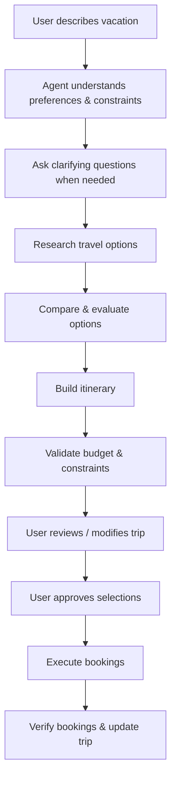

# Product Requirements Document: Personalized AI Travel Agent

## 1. Problem

Planning a vacation requires searching and coordinating multiple services such as
flights, hotels, rental cars, activities, restaurants, and experiences. Travelers
often know the type of vacation they want but still have to figure out where to go,
compare options across different platforms, coordinate the different parts of the
trip, stay within budget, and build an itinerary.

The goal of this project is to build a conversational AI travel agent that can
understand what kind of vacation a user wants, research relevant options, coordinate
the different components of the trip, create a personalized itinerary, and
eventually complete the required bookings.

## 2. Product Vision

The user describes the vacation they want; the AI handles the complexity of
planning and booking it. The user should be able to describe their desired
experience naturally without having to know the exact destination, hotel, flight,
or activities beforehand.

**Example:** "I want a relaxing 7-day luxury vacation somewhere warm in November.
I'm flying from Seattle and have a budget of $5,000 for two people."

The agent should progressively understand the user's preferences and constraints,
research suitable options, make recommendations, build an itinerary, and allow the
user to refine the plan through conversation.

The ultimate goal is to take the user from:
**"I want this kind of vacation" → "Here's your personalized trip" → "I've booked it for you."**

## 3. How It Works

The agent should maintain a shared understanding of the current trip so that
decisions about one component can influence other components.

## 4. User Prompts & Conversation Types

The agent should be able to handle these different interactions while maintaining
context about the current trip.

| Conversation type | Example prompt(s) |
|---|---|
| Trip Discovery | "I want to go somewhere warm in November." / "Where should I go for a romantic vacation?" |
| Destination-Specific | "Plan me a 7-day trip to Japan." / "I want to visit Hawaii but haven't decided where." |
| Budget-Driven | "I have $3,000 for two people. Where can we go for 5 days?" |
| Experience-Driven | "I want a luxury resort, good food, beaches, and a couple of adventurous activities." |
| Constraint-Driven | "I don't want to drive much." / "I don't want to change hotels during the trip." |
| Existing Trip | "I already booked my flight to Maui. Plan everything else." |
| Modification | "This itinerary has too much sightseeing. Make it more relaxing." / "Replace the hiking activity with something more luxurious." |
| Comparison | "Which is better for me — Cabo or Maui?" |
| Re-planning | "The hotel you recommended is unavailable. Find me another one." |
| Booking | "Book the hotel we selected." / "Book the flight and rental car." |

## 5. Core Travel Components

| Component | Purpose |
|---|---|
| Destination | Discover and evaluate suitable destinations |
| Flight | Research and book flights |
| Hotel | Research and book accommodation |
| Rental Car | Determine whether a car is needed and find/book suitable options |
| Activities | Research and book tours, experiences, attractions, and other activities |
| Itinerary | Combine selected components into a coherent day-by-day plan |
| Budget | Track estimated and final trip costs |

Additional components such as restaurants and other travel services can be added
later if they fit naturally into the product.

## 6. How Travel Components Interact

The travel components should not operate as completely independent searches — they
should share information about the same trip and influence each other's decisions.

- **Flight → Hotel**: Flight dates and arrival/departure times determine the
  hotel's required dates and can influence the practicality of certain hotel
  options.
- **Hotel → Activities**: The hotel's location can influence which activities are
  convenient and how much travel time is required.
- **Hotel → Rental Car**: The need for a rental car should depend on factors such
  as hotel location, available transportation, planned activities, and the user's
  preference for driving.
- **Activities → Itinerary**: Activities must fit around flight schedules, hotel
  location, travel time, activity duration, and the user's preferred pace.
- **All Components → Budget**: The agent should consider the overall trip budget
  rather than optimizing each component independently (e.g. trading off a pricier
  hotel against a cheaper flight or fewer paid activities).
- **User Preferences → All Components**: Preferences should be applied across the
  entire trip (e.g. a stated preference to avoid driving should rule out
  activities or hotel locations that would require it).

---

See `docs/architecture.md` for how this product scope maps onto the multi-agent
implementation (Supervisor, Enhancer, Researcher, Planner, Booker), and
`docs/pending-items.md` for what's deferred relative to this PRD's full scope
(e.g. Activities, Rental Cars, and Restaurants are PRD-scoped components not yet
built — see architecture.md §9 Roadmap).
